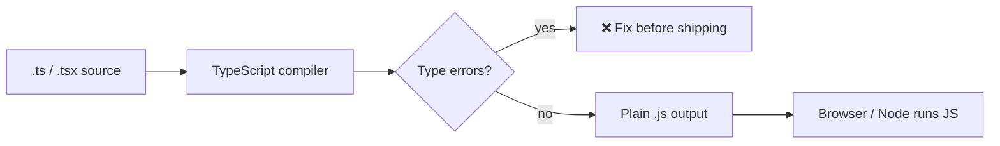

# 01 — Why TypeScript

**Level:** Beginner

---

## 1. Overview

TypeScript is JavaScript **plus a type system**. You write types, the compiler checks them, and the output is plain JavaScript. Types exist only at compile time and are erased at runtime.

### Flow diagram — what happens to your code



---

## 2. Where it is actually used

| Situation | Example |
|---|---|
| Catching bugs early | Passing a `string` where a `number` is expected |
| Editor autocomplete | `user.` shows `name`, `email`, `role` |
| Safe refactoring | Rename a field and every usage is flagged |
| Team APIs | Component props and function signatures act as documentation |
| Frontend jobs | React / Next.js codebases are mostly TypeScript |

---

## 3. How it works

```text
JS:  bug appears at RUNTIME   (user sees it)
TS:  bug appears at COMPILE   (you see it)
```

- TypeScript is a **superset** of JavaScript: all valid JS is valid TS.
- The compiler (`tsc`) or a bundler (Vite, Next.js) strips types and emits JS.
- **Types are erased.** At runtime there is no `string` or `User` — only JS values.
- So TypeScript does **not** validate API data at runtime. Use a validator (e.g. Zod) for that.

---

## 4. Syntax (TypeScript)

```ts
// JavaScript — runs, then breaks
function total(price, qty) {
  return price * qty;
}
total("10", 2); // 20 by accident (string coerced)

// TypeScript — caught immediately
function total(price: number, qty: number): number {
  return price * qty;
}
total("10", 2); // ❌ Argument of type 'string' is not assignable to parameter of type 'number'
```

Recommended starting point in `tsconfig.json`:

```json
{
  "compilerOptions": {
    "strict": true
  }
}
```

---

## 5. Common mistakes

```ts
// ❌ Believing types exist at runtime
interface User { name: string }
if (typeof data === "User") {}   // no such thing — types are erased

// ✅ Check real values
if (typeof data.name === "string") {}
```

```ts
// ❌ Trusting fetch data because it is "typed"
const user = (await res.json()) as User;   // just a claim, not a check

// ✅ Validate at the boundary when data is untrusted
const user = userSchema.parse(await res.json());
```

---

## 6. Interview questions (samples / hints)

**Beginner**  
Q: What problem does TypeScript solve?  
A: It catches type errors at compile time instead of runtime, and gives better autocomplete and refactoring safety.

**Beginner**  
Q: Is TypeScript a separate language from JavaScript?  
A: It is a superset of JS. It compiles down to plain JS, and the types are erased.

**Intermediate**  
Q: Does TypeScript check data coming from an API at runtime?  
A: No. Types are erased, so a typed `fetch` result is only an assumption. Use runtime validation (Zod, etc.) if the data is untrusted.

> These are thinking samples. Real interview questions change with company and year.
