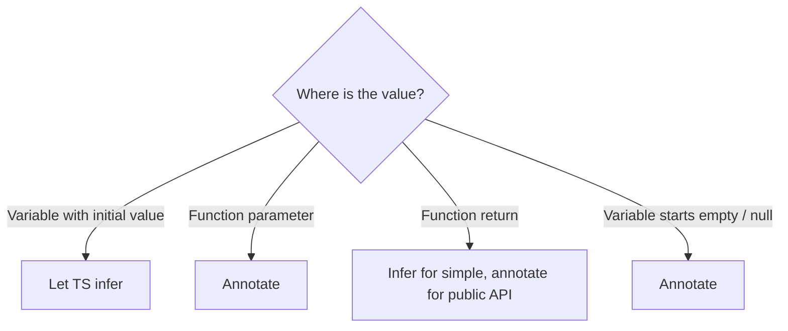

# 02 — Basic Types & Inference

**Level:** Beginner

---

## 1. Overview

Basic types describe primitive values, arrays, and tuples. You can annotate variables, parameters, and return types — but TypeScript can often **infer** the type for you.

### Decision diagram — annotate or let TS infer?



---

## 2. Where it is actually used

| Situation | Example |
|---|---|
| Function parameters | `(id: number, name: string)` |
| Arrays of data | `User[]`, `string[]` |
| Fixed pairs | `[number, number]` for coordinates |
| Empty initial state | `const [user, setUser] = useState<User | null>(null)` |

---

## 3. How it works

```text
const age = 30;        →  TS infers  number
let name = "Asha";     →  TS infers  string
const tags = ["a"];    →  TS infers  string[]
```

`const` with a primitive infers the **literal** (`const x = 5` is type `5`), `let` widens it (`let x = 5` is `number`).

---

## 4. Syntax (TypeScript)

```ts
const name: string = "Asha";
const age: number = 21;
const active: boolean = true;
const nothing: null = null;
let notSet: undefined = undefined;

// Arrays — two equivalent forms
const ids: number[] = [1, 2, 3];
const tags: Array<string> = ["a", "b"];

// Tuple — fixed length, fixed order
const point: [number, number] = [10, 20];
const entry: [string, number] = ["age", 21];

// Function: annotate parameters, return type optional but good for public APIs
function add(a: number, b: number): number {
  return a + b;
}

// Inference: no annotation needed
const total = add(1, 2);        // number
const names = ["a", "b"].map(s => s.toUpperCase()); // string[]
```

---

## 5. Common mistakes

```ts
// ❌ Over-annotating what TS already knows
const count: number = 0;

// ✅ Let inference work
const count = 0;
```

```ts
// ❌ Empty array gives TS nothing to infer from
const items = [];

// ✅ Annotate empty containers
const items: string[] = [];
```

```ts
// ❌ Forgetting null
let user: User = null;     // error with strictNullChecks

// ✅
let user: User | null = null;
```

---

## 6. Interview questions (samples / hints)

**Beginner**  
Q: Array vs tuple?  
A: An array is any length of one type (`number[]`). A tuple has a fixed length and a type per position (`[string, number]`).

**Beginner**  
Q: When do you not need a type annotation?  
A: When TS can infer from the initial value or from context, e.g. `const n = 5` or a `map` callback parameter.

**Intermediate**  
Q: `string[]` vs `Array<string>`?  
A: Identical. `string[]` is the common style.

> These are thinking samples. Real interview questions change with company and year.
