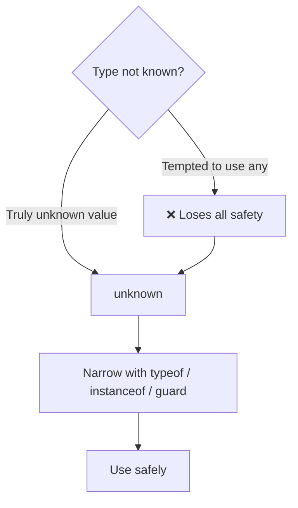

# 03 — any vs unknown

**Level:** Beginner → Intermediate

---

## 1. Overview

`any` turns off type checking for a value. `unknown` means “I don't know the type yet” and forces you to **check before using it**.

### Decision diagram



---

## 2. Where it is actually used

| Situation | Example |
|---|---|
| `catch` clauses | `catch (e: unknown)` |
| Parsed JSON | `JSON.parse` result before validation |
| Generic utility inputs | Logger that accepts any value |
| Migrating JS to TS | Temporary `any` (then remove it) |

---

## 3. How it works

```text
any      →  can do anything, no checks        (unsafe)
unknown  →  must narrow first, then use       (safe)
```

Anything is assignable **to** `unknown`. But `unknown` is only assignable to `unknown` and `any` until you narrow it.

---

## 4. Syntax (TypeScript)

```ts
let a: any = "hello";
a.toFixed();            // no error — crashes at runtime

let u: unknown = "hello";
u.toUpperCase();        // ❌ 'u' is of type 'unknown'

if (typeof u === "string") {
  u.toUpperCase();      // ✅ narrowed to string
}

try {
  riskyCall();
} catch (e: unknown) {
  if (e instanceof Error) console.error(e.message);
}
```

---

## 5. Common mistakes

```ts
// ❌ any spreads silently
function parse(json: string): any { return JSON.parse(json); }
const user = parse(raw);
user.nmae;   // typo — no error

// ✅ unknown forces a check (or validate with a schema)
function parse(json: string): unknown { return JSON.parse(json); }
```

```ts
// ❌ Using `as` to silence the compiler
const user = data as User;

// ✅ Narrow or validate
if (isUser(data)) { /* data is User */ }
```

---

## 6. Interview questions (samples / hints)

**Beginner**  
Q: any vs unknown?  
A: `any` disables checking. `unknown` is the type-safe version — you must narrow it before using it.

**Intermediate**  
Q: Why is `any` bad?  
A: It defeats the purpose of TypeScript and spreads: values derived from `any` also become `any`.

**Intermediate**  
Q: What type should a `catch` variable be?  
A: `unknown`, then narrow with `instanceof Error`.

> These are thinking samples. Real interview questions change with company and year.
