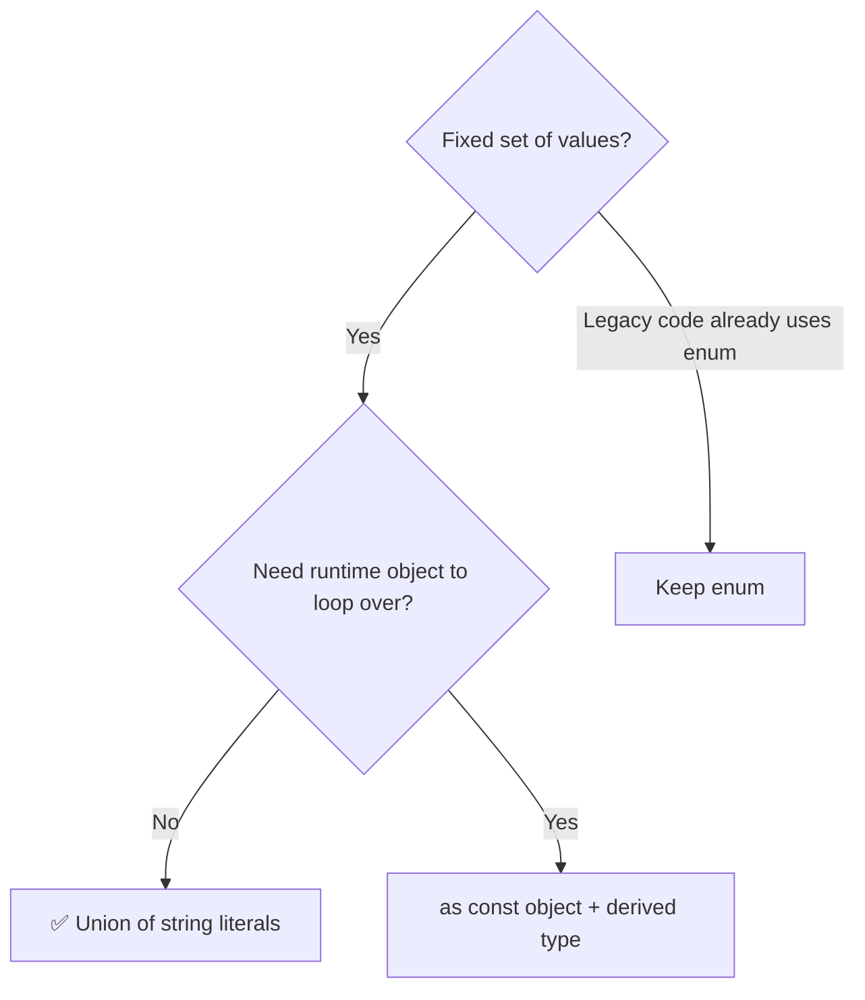

# 04 — Literal Types & Enums

**Level:** Beginner → Intermediate

---

## 1. Overview

A **literal type** is an exact value (`"success"`, `42`, `true`). Combined with `|` it models a fixed set of allowed values. Many teams prefer this over `enum`.

### Decision diagram — enum or literal union?



---

## 2. Where it is actually used

| Situation | Example |
|---|---|
| Status fields | `"idle" \| "loading" \| "error"` |
| Component variants | `variant: "primary" \| "ghost"` |
| Roles | `"admin" \| "user"` |
| HTTP methods | `"GET" \| "POST"` |

---

## 3. How it works

```text
type Status = "success" | "error";
let s: Status = "success";  ✅
s = "done";                 ❌ not assignable to Status
```

Literal unions are erased at runtime (zero JS output). A TS `enum` generates a real JS object.

---

## 4. Syntax (TypeScript)

```ts
type Status = "success" | "error";
type Size = "sm" | "md" | "lg";
type Dice = 1 | 2 | 3 | 4 | 5 | 6;

// enum
enum Role { Admin, User }            // numeric
enum Level { Low = "LOW", High = "HIGH" } // string

// Union alternative — no runtime code
type Role2 = "admin" | "user";

// Need values at runtime AND a type? as const
const ROLES = ["admin", "user"] as const;
type RoleName = (typeof ROLES)[number];   // "admin" | "user"
```

---

## 5. Common mistakes

```ts
// ❌ Plain string widens
function setStatus(s: string) {}
setStatus("sucess");   // typo accepted

// ✅ Literal union catches it
function setStatus(s: Status) {}
setStatus("sucess");   // ❌ error
```

```ts
// ❌ let widens a literal
let status = "success";           // type: string

// ✅ const keeps literal, or annotate
const status = "success";         // type: "success"
let status2: Status = "success";
```

---

## 6. Interview questions (samples / hints)

**Beginner**  
Q: What is a literal type?  
A: A type that allows exactly one value, like `"success"`. Unions of literals model a fixed set of options.

**Intermediate**  
Q: enum vs union of string literals?  
A: Enums emit runtime code and can be awkward (numeric enums are loose). Literal unions are erased, simpler, and play well with JSON and narrowing — many teams prefer them.

**Intermediate**  
Q: How do you derive a type from an array of values?  
A: `as const` plus `(typeof arr)[number]`.

> These are thinking samples. Real interview questions change with company and year.
