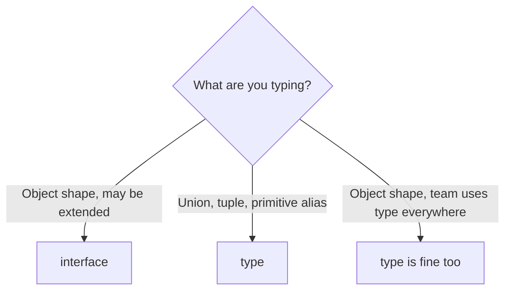

# 05 — Objects & Interfaces

**Level:** Beginner → Intermediate

---

## 1. Overview

Objects are how real app data is modeled (`User`, `Post`, `Comment`). You describe their shape with an `interface` or a `type` alias. This is what you will write constantly day-to-day.

### Decision diagram — interface or type?



Both work for most everyday objects. Stay **consistent** within a codebase.

---

## 2. Where it is actually used

| Situation | Example |
|---|---|
| API data | `User`, `Product`, `Order` |
| Component props | `ButtonProps` |
| Config objects | `{ apiUrl: string; retries?: number }` |
| Lookup maps | `{ [id: string]: User }` |

---

## 3. How it works

| | `interface` | `type` |
|---|---|---|
| Object shapes | ✅ | ✅ |
| Extend | `extends` | `&` (intersection) |
| Declaration merging | ✅ (same name merges) | ❌ |
| Unions / tuples / primitives | ❌ | ✅ |

```text
interface B extends A    → B has everything from A, errors if they conflict
type C = A & B           → C must satisfy both
```

---

## 4. Syntax (TypeScript)

```ts
interface User {
  id: number;
  name: string;
  email?: string;          // optional
  readonly createdAt: Date; // cannot be reassigned
  address: {               // nested object
    city: string;
    zip?: string;
  };
}

// extends vs intersection
interface Admin extends User { permissions: string[] }
type Admin2 = User & { permissions: string[] };

// Relationships
interface Post { id: number; author: User; comments: Comment[] }
interface Comment { id: number; postId: number; text: string; author: User }

// Index signature: dynamic keys
interface Scores { [player: string]: number }
const scores: Scores = { asha: 10, ravi: 8 };

// Same idea with Record
const scores2: Record<string, number> = { asha: 10 };
```

---

## 5. Common mistakes

```ts
// ❌ Everything optional "just in case"
interface User { id?: number; name?: string }

// ✅ Optional only when truly optional
interface User { id: number; name: string; nickname?: string }
```

```ts
// ❌ Mutating a readonly field
user.createdAt = new Date();   // error

// ✅ Create a new object instead
const updated = { ...user, name: "New" };
```

```ts
// ❌ Index signature hides typos
scores.asah;                 // typed as number, may be undefined at runtime

// ✅ Handle missing keys
const s = scores["asah"] ?? 0;
```

---

## 6. Interview questions (samples / hints)

**Beginner**  
Q: interface vs type?  
A: Both describe object shapes. Interfaces can be extended and merged; type aliases are more flexible (unions, tuples, primitives). Either is fine for everyday objects.

**Beginner**  
Q: What does `?` mean on a property?  
A: The property may be missing; its type becomes `T | undefined`.

**Intermediate**  
Q: `extends` vs `&`?  
A: `extends` reports conflicts as errors on the declaration. `&` combines types and conflicting properties can silently become `never`.

**Intermediate**  
Q: When use an index signature?  
A: When keys are dynamic (lookup tables). Prefer `Record<K, V>` for clarity.

> These are thinking samples. Real interview questions change with company and year.
