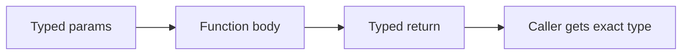

# 06 — Functions

**Level:** Beginner → Intermediate

---

## 1. Overview

Type the **inputs** (parameters) and the **output** (return). Callbacks and function-valued props need function types too.

### Flow diagram



---

## 2. Where it is actually used

| Situation | Example |
|---|---|
| Utilities | `debounce`, `groupBy`, `formatDate` |
| Event callbacks | `onSelect: (id: number) => void` |
| API helpers | `getUser(id): Promise<User>` |
| Component props | `onClick: () => void` |

---

## 3. How it works

```text
(a: number, b: number) => number
 └── params ──────────┘    └ return
```

- Parameters are required unless marked `?` or given a default.
- `void` means “return value is ignored”. It is not the same as `undefined`.
- Return types are usually inferred; annotate them on exported / public functions.

---

## 4. Syntax (TypeScript)

```ts
function add(a: number, b: number): number {
  return a + b;
}

const greet = (name: string, greeting = "Hello"): string => `${greeting}, ${name}`;

function log(message: string, level?: "info" | "warn"): void {
  console.log(level ?? "info", message);
}

// Function type alias
type Comparator = (a: number, b: number) => number;
const asc: Comparator = (a, b) => a - b;

// Callback param
function fetchUser(id: number, onDone: (user: User) => void): void {}

// Async
async function getUser(id: number): Promise<User> {
  const res = await fetch(`/api/users/${id}`);
  return res.json();
}

// Rest params
function sum(...nums: number[]): number {
  return nums.reduce((a, b) => a + b, 0);
}
```

---

## 5. Common mistakes

```ts
// ❌ Optional param before required
function f(a?: number, b: number) {}

// ✅ Required first, optional last
function f(b: number, a?: number) {}
```

```ts
// ❌ Forgetting Promise
async function getUser(): User {}

// ✅
async function getUser(): Promise<User> {}
```

```ts
// ❌ Unused implicit any parameter
const handler = (e) => {};

// ✅
const handler = (e: React.MouseEvent<HTMLButtonElement>) => {};
```

---

## 6. Interview questions (samples / hints)

**Beginner**  
Q: How do you type an optional or default parameter?  
A: `b?: number` or `b = 10`. Optional params must come after required ones.

**Intermediate**  
Q: `void` vs `undefined` as a return type?  
A: `void` means the return value should not be used. A callback typed `() => void` can still return something; the caller ignores it.

**Intermediate**  
Q: What is the return type of an `async function`?  
A: Always `Promise<T>`.

> These are thinking samples. Real interview questions change with company and year.
