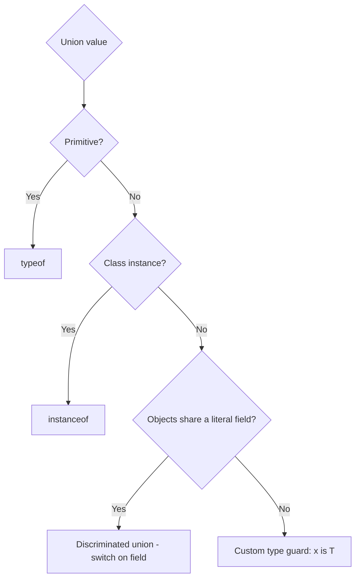

# 07 — Unions & Narrowing

**Level:** Intermediate  
**Priority:** 🔥 Highest-yield topic

---

## 1. Overview

A **union** (`A | B`) is a value that can be one of several shapes. **Narrowing** is how TypeScript figures out which one you have inside an `if`. This separates “knows TS syntax” from “thinks in types”.

### Decision diagram — which narrowing tool?



---

## 2. Where it is actually used

| Situation | Example |
|---|---|
| API result states | `loading \| success \| error` |
| Optional values | `User \| null` |
| Reducer actions | `{ type: "add" } \| { type: "remove"; id: number }` |
| Props variants | `{ kind: "link"; href: string } \| { kind: "button"; onClick: () => void }` |

---

## 3. How it works

```text
function f(x: string | number) {
  x            // string | number
  if (typeof x === "string") {
    x          // string
  } else {
    x          // number
  }
}
```

Narrowing checks: `typeof`, `instanceof`, truthiness, equality, `in`, and a shared literal field (discriminant).

---

## 4. Syntax (TypeScript)

```ts
// typeof / instanceof / truthiness
function format(v: string | number | null) {
  if (v === null) return "-";
  if (typeof v === "string") return v.trim();
  return v.toFixed(2);
}

function msg(e: Error | string) {
  return e instanceof Error ? e.message : e;
}

// Discriminated union
type Result =
  | { status: "loading" }
  | { status: "success"; data: string[] }
  | { status: "error"; error: string };

function render(r: Result) {
  switch (r.status) {
    case "loading": return "Loading…";
    case "success": return r.data.join(", ");   // data available here
    case "error":   return r.error;             // error available here
  }
}

// Custom type guard
function isUser(x: unknown): x is User {
  return typeof x === "object" && x !== null && "id" in x && "name" in x;
}

// Exhaustiveness check
function assertNever(x: never): never {
  throw new Error("Unexpected: " + JSON.stringify(x));
}
// default: return assertNever(r);  // compile error if a case is missing
```

---

## 5. Common mistakes

```ts
// ❌ Accessing a field that exists on only one member
function f(r: Result) { return r.data; }   // error

// ✅ Narrow first
function f(r: Result) { return r.status === "success" ? r.data : []; }
```

```ts
// ❌ Truthiness trap — 0 and "" are falsy
if (count) {}          // skips 0

// ✅ Be explicit
if (count !== undefined) {}
```

```ts
// ❌ Casting instead of narrowing
(r as { data: string[] }).data;

// ✅ Narrow with the discriminant
```

---

## 6. Interview questions (samples / hints)

**Beginner**  
Q: What is a union type?  
A: A type that can be one of several types, written `A | B`.

**Intermediate**  
Q: What is a discriminated union?  
A: A union where every member has a common literal field (like `status`). Checking that field narrows to exactly one member.

**Intermediate**  
Q: What does `x is User` do in a return type?  
A: It makes the function a type guard: when it returns `true`, TS narrows `x` to `User`.

**Advanced / Scenario**  
Q: How do you make sure every union case is handled?  
A: Add a `default` branch that assigns the value to `never`. Adding a new member then produces a compile error.

> These are thinking samples. Real interview questions change with company and year.
