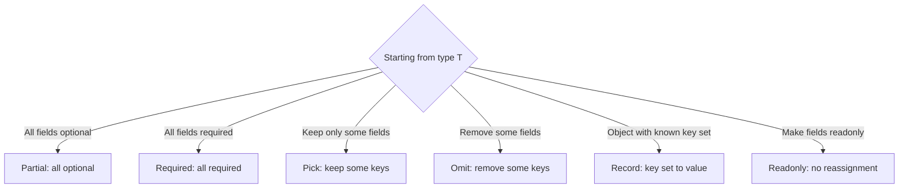

# 08 — Utility Types

**Level:** Intermediate  
**Priority:** 🔥 High

---

## 1. Overview

Utility types **derive new types from existing ones** so you do not copy-paste shapes. Know what each does and when to reach for it.

### Decision diagram — which utility?



---

## 2. Where it is actually used

| Utility | Real usage |
|---|---|
| `Partial<T>` | PATCH / update payloads, form drafts |
| `Required<T>` | Config after defaults are applied |
| `Pick<T, K>` | Card that needs only `id` and `name` |
| `Omit<T, K>` | Create payload without `id` / `createdAt` |
| `Record<K, V>` | Lookup by role, status → label map |

---

## 3. How it works

```text
interface User { id: number; name: string; email: string }

Partial<User>            → { id?: number; name?: string; email?: string }
Pick<User, "id"|"name">  → { id: number; name: string }
Omit<User, "id">         → { name: string; email: string }
Record<"a"|"b", number>  → { a: number; b: number }
```

---

## 4. Syntax (TypeScript)

```ts
interface User {
  id: number;
  name: string;
  email: string;
  role: "admin" | "user";
}

type UserDraft   = Partial<User>;
type StrictUser  = Required<User>;
type UserPreview = Pick<User, "id" | "name">;
type NewUser     = Omit<User, "id">;

// Update function: only changed fields
function updateUser(id: number, changes: Partial<Omit<User, "id">>) {}

// Label map — compile error if a role is missing
const roleLabel: Record<User["role"], string> = {
  admin: "Administrator",
  user: "Member",
};
```

---

## 5. Common mistakes

```ts
// ❌ Duplicating the shape by hand
interface UserPreview { id: number; name: string }

// ✅ Derive it, stays in sync
type UserPreview = Pick<User, "id" | "name">;
```

```ts
// ❌ Partial on everything
function save(user: Partial<User>) {}   // can save an empty object

// ✅ Partial only for updates
function save(user: User) {}
function patch(id: number, changes: Partial<User>) {}
```

```ts
// ❌ Record<string, V> hides missing keys
const labels: Record<string, string> = {};

// ✅ Restrict the keys
const labels: Record<User["role"], string> = { admin: "A", user: "U" };
```

---

## 6. Interview questions (samples / hints)

**Beginner**  
Q: What does `Partial<T>` do?  
A: Makes every property of `T` optional.

**Intermediate**  
Q: Pick vs Omit?  
A: `Pick` keeps the listed keys; `Omit` removes the listed keys. Choose whichever list is shorter.

**Intermediate**  
Q: Why would you use `Partial<T>` here (update endpoint)?  
A: A PATCH only sends changed fields, so every field is optional. Often `Partial<Omit<T, "id">>`.

**Intermediate**  
Q: What does `Record<K, V>` give you over `{ [key: string]: V }`?  
A: A fixed key set when `K` is a union, so missing or extra keys are compile errors.

> These are thinking samples. Real interview questions change with company and year.
