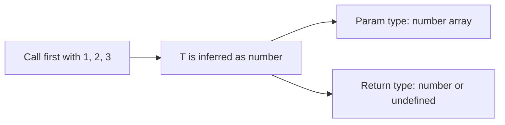

# 09 — Generics

**Level:** Intermediate  
**Priority:** 🔥 High (basic level only)

---

## 1. Overview

A generic is a function or type written over a **placeholder** (`<T>`). It keeps the type relationship between input and output instead of falling back to `any`. Interview scope: write a simple generic function and a generic type — not conditional or mapped types.

### Flow diagram



---

## 2. Where it is actually used

| Situation | Example |
|---|---|
| Utilities | `groupBy<T>`, `unique<T>` |
| API wrappers | `ApiResponse<T>` |
| Hooks | `useFetch<T>(url)` |
| Components | `List<T>` that renders any item type |
| Built-ins you already use | `Array<T>`, `Promise<T>`, `useState<T>` |

---

## 3. How it works

```text
function identity<T>(value: T): T

identity("a")    → T inferred as string
identity(5)      → T inferred as number
```

`<T extends X>` is a **constraint**: T can be any type that at least satisfies X.

---

## 4. Syntax (TypeScript)

```ts
function first<T>(items: T[]): T | undefined {
  return items[0];
}

// Typed groupBy
function groupBy<T, K extends string | number>(
  items: T[],
  getKey: (item: T) => K
): Record<K, T[]> {
  const result = {} as Record<K, T[]>;
  for (const item of items) {
    const key = getKey(item);
    (result[key] ??= []).push(item);
  }
  return result;
}

const byRole = groupBy(users, u => u.role);   // Record<"admin" | "user", User[]>

// Generic type
type ApiResponse<T> =
  | { status: "loading" }
  | { status: "success"; data: T }
  | { status: "error"; error: string };

// Constraint
function getId<T extends { id: number }>(item: T): number {
  return item.id;
}

// Default type parameter
interface Page<T = unknown> { items: T[]; total: number }
```

---

## 5. Common mistakes

```ts
// ❌ any instead of a generic
function first(items: any[]): any { return items[0]; }

// ✅ Keeps the connection
function first<T>(items: T[]): T | undefined { return items[0]; }
```

```ts
// ❌ Accessing a property with no constraint
function getId<T>(item: T) { return item.id; }  // error

// ✅
function getId<T extends { id: number }>(item: T) { return item.id; }
```

```ts
// ❌ Generic that is used only once adds nothing
function log<T>(x: T): void {}

// ✅ Use unknown or a plain type
function log(x: unknown): void {}
```

---

## 6. Interview questions (samples / hints)

**Beginner**  
Q: What is a generic?  
A: A placeholder type (`<T>`) so one function or type works for many types while keeping type safety.

**Intermediate**  
Q: Why generic instead of `any`?  
A: A generic keeps the link between input and output types; `any` loses it.

**Intermediate**  
Q: What does `T extends { id: number }` mean?  
A: `T` must have at least an `id: number`. It allows using `.id` safely.

**Intermediate**  
Q: Write a typed `groupBy`.  
A: See the example above — `items: T[]`, `getKey: (item: T) => K`, return `Record<K, T[]>`.

> These are thinking samples. Real interview questions change with company and year.
