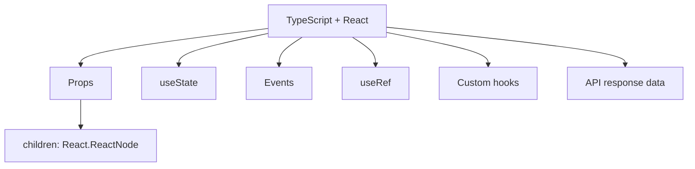

# 10 — TypeScript with React

**Level:** Intermediate  
**Priority:** 🔥 Highest-yield for frontend roles

---

## 1. Overview

This is where TypeScript interview questions actually land for a frontend role: typing **props, state, events, refs, and hooks** correctly with no `any`.

### Decision diagram — what to type first



---

## 2. Where strong typing is actually used

| Area | Real usage |
|---|---|
| Props | Every component public API |
| State | `User \| null`, arrays of items |
| Events | `onChange`, `onSubmit`, `onClick` |
| Refs | Focus an input, measure a div |
| Hooks | `useFetch<T>` return shape |
| API data | `User`, `Product`, `Order` types |

---

## 3. Props

```tsx
interface ButtonProps {
  label: string;
  variant?: "primary" | "ghost";
  disabled?: boolean;
  onClick: () => void;
}

function Button({ label, variant = "primary", disabled, onClick }: ButtonProps) {
  return <button className={variant} disabled={disabled} onClick={onClick}>{label}</button>;
}

interface CardProps {
  title: string;
  children: React.ReactNode;
}
```

---

## 4. useState

```tsx
const [count, setCount] = useState(0);                 // inferred number
const [name, setName] = useState("");                  // inferred string
const [user, setUser] = useState<User | null>(null);   // explicit: starts null
const [items, setItems] = useState<Item[]>([]);        // explicit: empty array
```

Rule: if the initial value does not show the full type, pass the type argument.

---

## 5. Events

```tsx
function handleChange(e: React.ChangeEvent<HTMLInputElement>) {
  setValue(e.target.value);
}

function handleClick(e: React.MouseEvent<HTMLButtonElement>) {}

function handleSubmit(e: React.FormEvent<HTMLFormElement>) {
  e.preventDefault();
}
```

---

## 6. useRef

```tsx
// DOM ref — starts null, React fills it
const inputRef = useRef<HTMLInputElement>(null);
inputRef.current?.focus();

// Mutable value ref — not tied to DOM, no re-render
const timerRef = useRef<number | null>(null);
```

---

## 7. Custom hooks and API data

```tsx
interface User { id: number; name: string }

// Tuple return
function useToggle(initial = false): [boolean, () => void] {
  const [on, setOn] = useState(initial);
  return [on, () => setOn(v => !v)];
}

// Object return with generic
type FetchState<T> =
  | { status: "loading" }
  | { status: "success"; data: T }
  | { status: "error"; error: string };

function useFetch<T>(url: string): FetchState<T> {
  const [state, setState] = useState<FetchState<T>>({ status: "loading" });
  useEffect(() => {
    fetch(url)
      .then(res => res.json() as Promise<T>)
      .then(data => setState({ status: "success", data }))
      .catch((e: unknown) =>
        setState({ status: "error", error: e instanceof Error ? e.message : "Unknown" })
      );
  }, [url]);
  return state;
}

// Using it
const state = useFetch<User[]>("/api/users");
if (state.status === "loading") return <p>Loading…</p>;
if (state.status === "error") return <p>{state.error}</p>;
return <ul>{state.data.map(u => <li key={u.id}>{u.name}</li>)}</ul>;
```

---

## 8. Common mistakes

```tsx
// ❌ any props
function Card(props: any) {}

// ✅ Explicit props type
function Card({ title, children }: CardProps) {}
```

```tsx
// ❌ Wrong event type
onChange={(e: any) => setValue(e.target.value)}

// ✅
onChange={(e: React.ChangeEvent<HTMLInputElement>) => setValue(e.target.value)}
```

```tsx
// ❌ useState(null) infers null only
const [user, setUser] = useState(null);

// ✅
const [user, setUser] = useState<User | null>(null);
```

```tsx
// ❌ Ref without null handling
inputRef.current.focus();

// ✅
inputRef.current?.focus();
```

---

## 9. Interview questions (samples / hints)

**Beginner**  
Q: How do you type component props?  
A: Define an `interface` or `type` for the props object and annotate the parameter. Use `React.ReactNode` for `children`.

**Beginner**  
Q: How do you type `useState` when the initial value is `null`?  
A: `useState<User | null>(null)`.

**Intermediate**  
Q: How do you type an `onChange` handler for an input?  
A: `React.ChangeEvent<HTMLInputElement>`.

**Intermediate**  
Q: How do you type `useRef` for a DOM element?  
A: `useRef<HTMLDivElement>(null)`; then `current` can be `null`, so use `?.`.

**Intermediate**  
Q: How do you avoid `any` on fetch results?  
A: Define an interface for the data, type the hook or `fetch` result with it (or a generic `useFetch<T>`), and validate with a schema if the data is untrusted.

> These are thinking samples. Real interview questions change with company and year.
