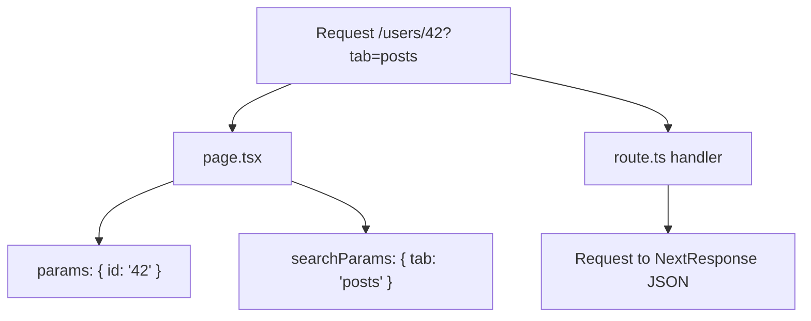

# 11 — TypeScript with Next.js

**Level:** Intermediate  
**Priority:** 🔥 High

---

## 1. Overview

Next.js (App Router) adds typing spots beyond plain React: page `params` / `searchParams`, Route Handlers, and typed server-side data.

### Flow diagram



---

## 2. Where it is actually used

| Area | Real usage |
|---|---|
| Dynamic pages | `app/users/[id]/page.tsx` |
| Search / filters | `searchParams` for `?tab=` / `?q=` |
| API routes | `app/api/users/route.ts` |
| Server data | Typed `fetch` / DB result passed as props |

---

## 3. params and searchParams

Dynamic segment values are always **strings** (or arrays for catch-all routes).

```tsx
// app/users/[id]/page.tsx
interface PageProps {
  params: Promise<{ id: string }>;
  searchParams: Promise<{ tab?: string }>;
}

export default async function UserPage({ params, searchParams }: PageProps) {
  const { id } = await params;
  const { tab = "profile" } = await searchParams;
  const userId = Number(id);               // convert string → number yourself
  return <h1>User {userId} — {tab}</h1>;
}
```

> In recent Next.js versions `params` and `searchParams` are Promises in the App Router. In older versions they were plain objects — check the version in your project.

---

## 4. Route Handlers

```ts
// app/api/users/route.ts
import { NextRequest, NextResponse } from "next/server";

interface User { id: number; name: string }
interface CreateUserBody { name: string }

export async function GET(request: NextRequest) {
  const q = request.nextUrl.searchParams.get("q");     // string | null
  const users: User[] = [];                            // from DB
  return NextResponse.json<User[]>(users);
}

export async function POST(request: NextRequest) {
  const body = (await request.json()) as CreateUserBody;   // validate in real code
  const user: User = { id: 1, name: body.name };
  return NextResponse.json<User>(user, { status: 201 });
}
```

---

## 5. Typing API data

```tsx
async function getUsers(): Promise<User[]> {
  const res = await fetch("https://api.example.com/users");
  if (!res.ok) throw new Error("Failed to load users");
  return res.json();
}

export default async function UsersPage() {
  const users = await getUsers();
  return <ul>{users.map(u => <li key={u.id}>{u.name}</li>)}</ul>;
}
```

Share the `User` type between the route handler and the page so they cannot drift apart.

---

## 6. Common mistakes

```tsx
// ❌ Treating id as a number
const user = users.find(u => u.id === params.id);   // number vs string

// ✅ Convert
const user = users.find(u => u.id === Number(id));
```

```ts
// ❌ Trusting the request body
const body = await request.json();   // any

// ✅ Type + validate (e.g. Zod) before using
```

```tsx
// ❌ Using hooks / event handlers in a server component
// ✅ Add "use client" at the top of components that need them
```

---

## 7. Interview questions (samples / hints)

**Intermediate**  
Q: How do you type `params` in a dynamic route?  
A: As an object of strings that matches the folder name — `{ id: string }` for `[id]` (a Promise of that object in recent versions).

**Intermediate**  
Q: What type are `searchParams` values?  
A: `string | string[] | undefined`, so each needs handling before use.

**Intermediate**  
Q: How do you type a Route Handler?  
A: Use `NextRequest` for the request and `NextResponse.json<T>()` for the response, and define interfaces for body and result.

**Advanced / Scenario**  
Q: How do you keep frontend and API types in sync?  
A: Share types, or derive them from a schema (`z.infer<typeof schema>`) used on both sides.

> These are thinking samples. Real interview questions change with company and year.
