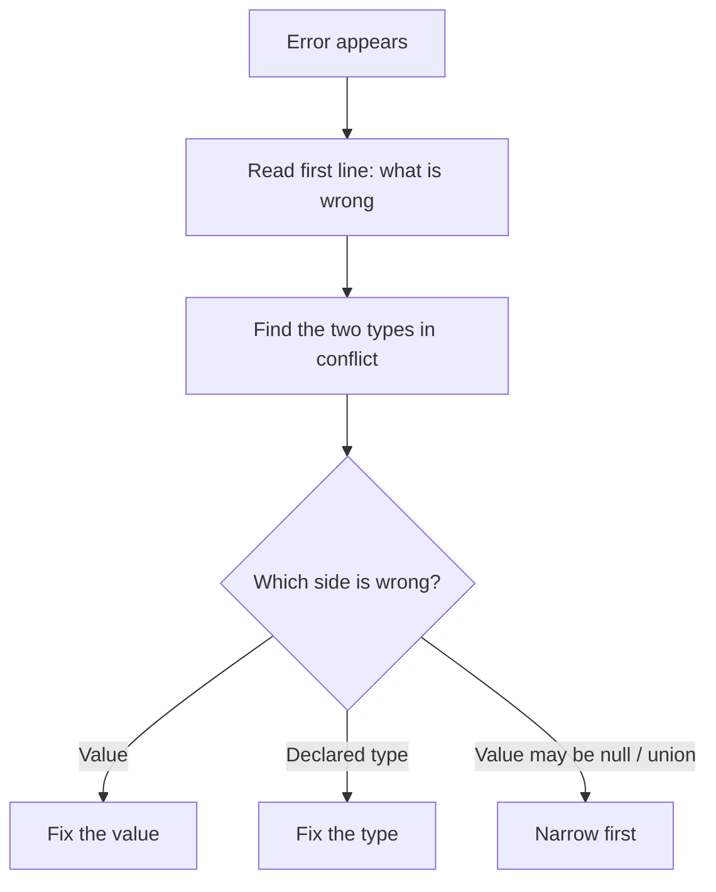

# 12 — Reading Type Errors

**Level:** Intermediate  
**Priority:** 🔥 High (very common interview format)

---

## 1. Overview

“What type error does this give and why?” is a classic pointed question. The skill: read the message, find the two types that disagree, and say why.

### Flow diagram — how to read an error



When the message is long, the **last indented line** is usually the real cause.

---

## 2. Where it is actually used

| Situation | Example |
|---|---|
| Interview | Broken snippet on a screen |
| Daily work | Red squiggles in the editor |
| Code review | “Why is this type unsafe?” |

---

## 3. Common errors cheat sheet

| Message (short) | Code | Usually means |
|---|---|---|
| Type 'X' is not assignable to type 'Y' | TS2322 | Value does not match the declared type |
| Argument of type 'X' is not assignable to parameter of type 'Y' | TS2345 | Wrong argument passed to a function |
| Property 'p' does not exist on type 'T' | TS2339 | Typo, or you need to narrow a union |
| 'x' is possibly 'null' / 'undefined' | TS18047 / TS18048 | Check before using |
| Parameter 'p' implicitly has an 'any' type | TS7006 | Add a type annotation |
| Property 'p' is missing in type 'X' but required in type 'Y' | TS2741 | Required field not provided |

---

## 4. Broken snippets (practice)

```ts
// 1
const age: number = "21";
// ❌ TS2322: Type 'string' is not assignable to type 'number'.
```

```ts
// 2
interface User { id: number; name: string }
const u: User = { id: 1 };
// ❌ TS2741: Property 'name' is missing in type '{ id: number; }' but required in type 'User'.
```

```ts
// 3
function len(s: string | null) {
  return s.length;
}
// ❌ TS18047: 's' is possibly 'null'.
// ✅ if (s === null) return 0;
```

```ts
// 4
type Result = { status: "ok"; data: string } | { status: "error"; error: string };
function f(r: Result) { return r.data; }
// ❌ TS2339: Property 'data' does not exist on type 'Result'.
//    Property 'data' does not exist on type '{ status: "error"; ... }'.
// ✅ Narrow on r.status first.
```

```tsx
// 5
const [user, setUser] = useState(null);
setUser({ id: 1, name: "A" });
// ❌ TS2345: Argument of type '{ id: number; name: string; }' is not assignable to parameter of type 'SetStateAction<null>'.
// ✅ useState<User | null>(null)
```

```ts
// 6
const double = (n) => n * 2;
// ❌ TS7006: Parameter 'n' implicitly has an 'any' type.
// ✅ (n: number) => n * 2
```

---

## 5. Common mistakes (when answering)

```text
❌ "TypeScript is just being annoying"
✅ "The function expects string | null, so I must handle null before .length"
```

```text
❌ Silencing with `as` or `any`
✅ Narrow, fix the type, or validate — then explain why
```

---

## 6. Interview questions (samples / hints)

**Beginner**  
Q: What does “Type 'string' is not assignable to type 'number'” mean?  
A: A value of one type is being used where another is declared; fix the value or the declared type.

**Intermediate**  
Q: Why is `'x' is possibly 'null'` raised, and how do you fix it?  
A: With `strictNullChecks`, a `T | null` value may be null. Narrow with a check, optional chaining, or a default.

**Intermediate**  
Q: Why can't I read `.data` on a union result?  
A: `data` exists only on some members. Narrow with the discriminant field first.

> These are thinking samples. Real interview questions change with company and year.
