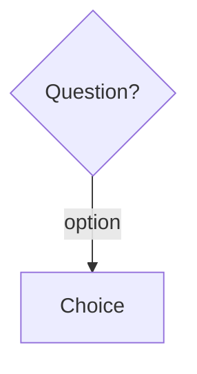

# Topic Name

**Level:** Beginner | Intermediate | Advanced

---

## 1. Overview

One or two sentences.

### Decision / flow diagram



---

## 2. Where it is actually used

| Situation | Example |
|---|---|
| ... | ... |

---

## 3. How it works

Short explanation + another diagram if helpful.

---

## 4. Syntax (TypeScript)

```ts
// clean example
```

---

## 5. Common mistakes

```ts
// ❌ Wrong
// ✅ Right
```

---

## 6. Interview questions

**Beginner**  
**Intermediate**  
**Advanced / Scenario**
