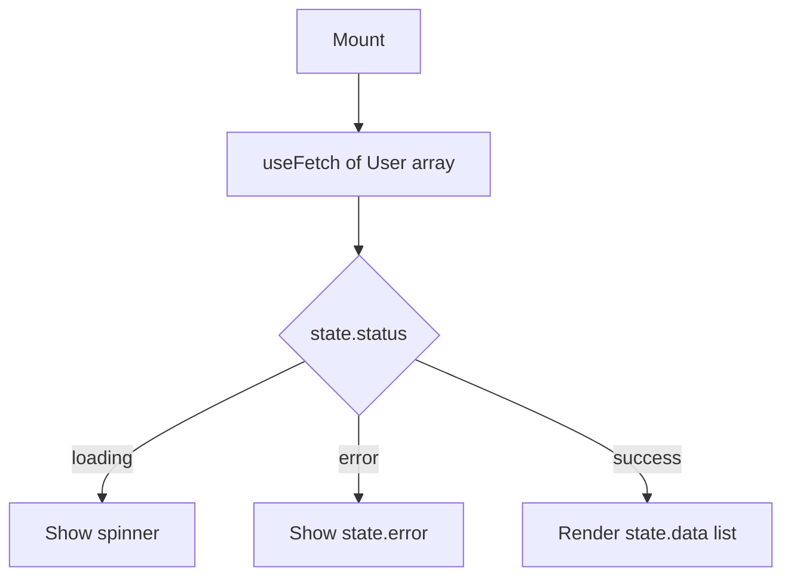
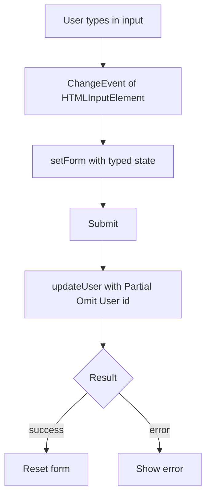
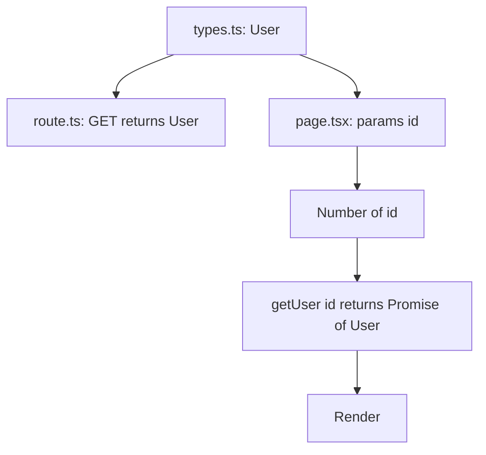

# Real-World Examples

Short end-to-end flows that combine multiple topics.  
Use these to connect isolated concepts into something that looks like real work.

---

## Flow 1 — Typed API response + discriminated union component

**Topics used:** Interfaces, Unions, Generics, React

### Goal
Fetch users and render loading, error, and success states with no `any`.

### Flow diagram

### What you should implement

1. `interface User` with realistic optional fields
2. `type FetchState<T>` as a discriminated union
3. `useFetch<T>(url)` returning `FetchState<T>`
4. A component that narrows on `state.status`

### Key learning

- `state.data` is only accessible after narrowing
- Generics keep the data type through the hook
- Add a `never` check to make adding a state a compile error

---

## Flow 2 — Typed form with events and update payload

**Topics used:** Events, useState, Utility types, Functions

### Goal
Edit a user with typed inputs and a `Partial` update payload.

### Flow diagram

### What you should implement

1. `useState<Pick<User, "name" | "email">>`
2. `handleChange(e: React.ChangeEvent<HTMLInputElement>)`
3. `handleSubmit(e: React.FormEvent<HTMLFormElement>)`
4. `updateUser(id: number, changes: Partial<Omit<User, "id">>)`

### Key learning

- Derive types from `User`; do not hand-copy fields
- Event types are specific to the element

---

## Flow 3 — Next.js page + Route Handler sharing a type

**Topics used:** Next.js typing, Interfaces, Async functions

### Goal
A dynamic user page and an API route that share one `User` type.

### Flow diagram

### What you should implement

1. `types/user.ts` exporting `User`
2. `app/api/users/[id]/route.ts` returning `NextResponse.json<User>()`
3. `app/users/[id]/page.tsx` typing `params`
4. Convert `id` from string to number

### Key learning

- Route params are strings
- One shared type prevents drift between API and UI

---

## How to practise these flows

1. Build each flow in a fresh app with `"strict": true`
2. Remove every `any` and every `as` cast you can
3. Break a type on purpose and read the error (topic 12)
4. Explain the data flow out loud as if in an interview

These three flows cover a large share of the TypeScript work a 2 YOE frontend role touches.
